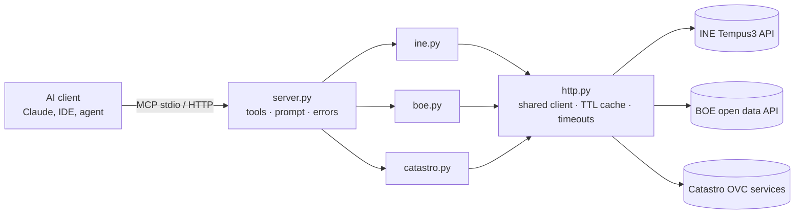

# Spain Open Data MCP

> Give AI agents reliable access to Spanish public data: **INE** statistics, the **BOE** and the **Catastro**.

[](https://github.com/gabicuesta/spain-open-data-mcp/actions/workflows/ci.yml)


🇪🇸 [Versión en español más abajo](#-en-español)

Ask your assistant things like:

- *"What was the annual CPI change in Spain in each of the last 6 months?"*
- *"Did the BOE publish anything about housing today?"*
- *"What's at 40.4168, -3.7038? How old is the building and how big is it?"*
- *"Write a renovation-oriented report for cadastral reference 9872023VH5797S0001WX."*

The model picks the right tools, chains them and cites the source of every figure.

## Why this exists

Spanish public data is excellent but scattered across three very different APIs: INE's JSON, the BOE's XML-shaped JSON and Catastro's legacy web services. Each one has its own conventions, casing and error formats. An agent that talks to them directly wastes tokens on parsing and gets things wrong.

This server hides those differences behind **8 small, typed, read-only tools** designed for LLMs: they return clean, structured output, they let the model limit how much it pulls into its context, and they turn upstream failures into short messages it can act on.

## Tools

| Source | Tool | What it does |
|---|---|---|
| INE | `ine_search_operations` | Find statistical operations (IPC, EPA, IPV…). Accent-insensitive. |
| INE | `ine_list_tables` | List the tables of an operation. |
| INE | `ine_get_table` | Latest N values of the series in a table, filterable by series name. |
| INE | `ine_get_series` | Latest N values of one series. |
| BOE | `boe_daily_summary` | What the BOE published on a day, filterable by keyword and section, with HTML/PDF links. |
| Catastro | `catastro_reference_from_coordinates` | Parcel and address at a point. On a street or square, the nearest parcels within ~50 m. |
| Catastro | `catastro_coordinates_from_reference` | Address and coordinates of a cadastral reference. |
| Catastro | `catastro_property_details` | Use, built area, year built and units of a property. |

It also includes a **`property_report` prompt** that chains Catastro, INE and the BOE into a short, sourced report about a property.

All tools are marked `readOnlyHint` / `openWorldHint`, so clients can auto-approve them safely.

## Quick start

```bash
# Run it without installing anything permanent (requires uv)
uvx --from git+https://github.com/gabicuesta/spain-open-data-mcp spain-open-data-mcp
```

### Claude Desktop / Claude Code

```json
{
  "mcpServers": {
    "spain-open-data": {
      "command": "uvx",
      "args": ["--from", "git+https://github.com/gabicuesta/spain-open-data-mcp", "spain-open-data-mcp"]
    }
  }
}
```

```bash
# Claude Code
claude mcp add spain-open-data -- uvx --from git+https://github.com/gabicuesta/spain-open-data-mcp spain-open-data-mcp
```

### Remote (Streamable HTTP)

```bash
spain-open-data-mcp --transport streamable-http --host 0.0.0.0 --port 8000
# endpoint: http://localhost:8000/mcp
```

## Architecture



- **`server.py`** only does wiring: tool schemas, descriptions written for the model, and translating errors.
- **One module per source** with pure async functions and Pydantic models. They're testable without MCP.
- **`http.py`** holds one shared `httpx` client, timeouts, a 10-minute in-memory cache and readable errors.

## Design decisions

The full records are in [`docs/adr`](docs/adr).

1. **Few, composable tools instead of one per endpoint.** Fewer tools means better tool selection by the model. ([ADR 0001](docs/adr/0001-tool-design-for-llms.md))
2. **The model controls output size.** Every tool has `limit`, `last_n` or `query`, and the defaults are small. Context is a budget. ([ADR 0001](docs/adr/0001-tool-design-for-llms.md))
3. **Tolerant parsing.** These APIs serialise XML to JSON: one element comes back as a dict, many as a list, and key casing varies. Parsers search generically instead of following fixed paths. ([ADR 0002](docs/adr/0002-tolerant-parsing.md))
4. **Errors are part of the UX.** `"Catastro: NO HAY NINGUNA PARCELA EN ESA UBICACION"` lets the model recover. A stack trace doesn't.
5. **Privacy by construction.** Only non-protected Catastro data exists in these services. No owners and no cadastral values.

## Development

```bash
git clone https://github.com/gabicuesta/spain-open-data-mcp && cd spain-open-data-mcp
uv venv && uv pip install -e ".[dev]"
pytest              # offline: fixtures + in-process MCP client
pytest -m live      # smoke tests against the real APIs
ruff check . && ruff format --check .
```

Try it interactively with the MCP Inspector:

```bash
npx @modelcontextprotocol/inspector uv run spain-open-data-mcp
```

The offline tests have two layers. **Unit tests** check each parser against recorded responses. **Protocol tests** call the tools through a real MCP client in-process: tool listing, annotations, structured output and error paths. The **live tests** catch upstream schema drift. CI runs them weekly.

## Roadmap

- [ ] More INE helpers: geographic filters and pre-selected housing and construction tables
- [ ] BOE consolidated legislation search
- [ ] Catastro: buildings within a radius, cartography (WMS) as images
- [ ] Optional persistent cache (SQLite) for heavy use
- [ ] Evals: a set of questions with expected answers to measure tool selection across models

## License

MIT. Data © INE, Agencia Estatal BOE and Dirección General del Catastro, under their respective reuse terms. This project is not affiliated with any of them.

---

## 🇪🇸 En español

**Servidor MCP que da a los agentes de IA acceso fiable a datos públicos españoles: estadísticas del INE, el BOE y el Catastro.**

Los datos públicos españoles son muy buenos, pero están repartidos en tres APIs muy distintas, cada una con sus convenciones, sus formatos y sus errores. Este servidor los unifica en **8 herramientas pequeñas, tipadas y de solo lectura**, pensadas para modelos de lenguaje: devuelven datos estructurados, dejan al modelo limitar cuánto contexto consume y convierten los fallos en mensajes accionables.

**Ejemplos de preguntas:**

- *"¿Cuál fue la variación anual del IPC en España en cada uno de los últimos 6 meses?"*
- *"¿Ha publicado hoy el BOE algo sobre vivienda?"*
- *"¿Qué hay en 40.4168, -3.7038? ¿De qué año es el edificio y qué superficie tiene?"*
- *"Prepara un informe orientado a reforma para la referencia catastral 9872023VH5797S0001WX."*

**Instalación:** usa la configuración de *Quick start*. Funciona con Claude Desktop, Claude Code y cualquier cliente MCP.

**Decisiones clave:**

- Pocas herramientas que se combinan bien.
- Salida acotada por defecto.
- Parsing tolerante a las rarezas de cada API.
- Errores legibles.
- Solo datos no protegidos del Catastro: ni titulares ni valores catastrales.

Las decisiones completas están en [`docs/adr`](docs/adr).
